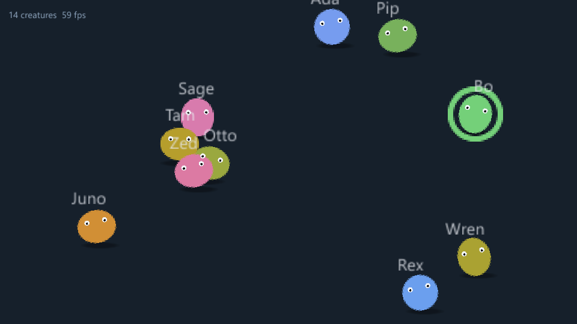
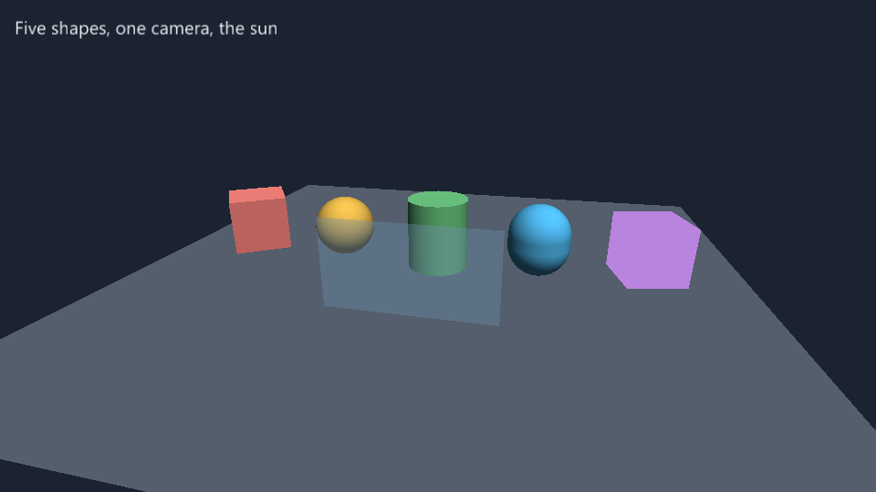
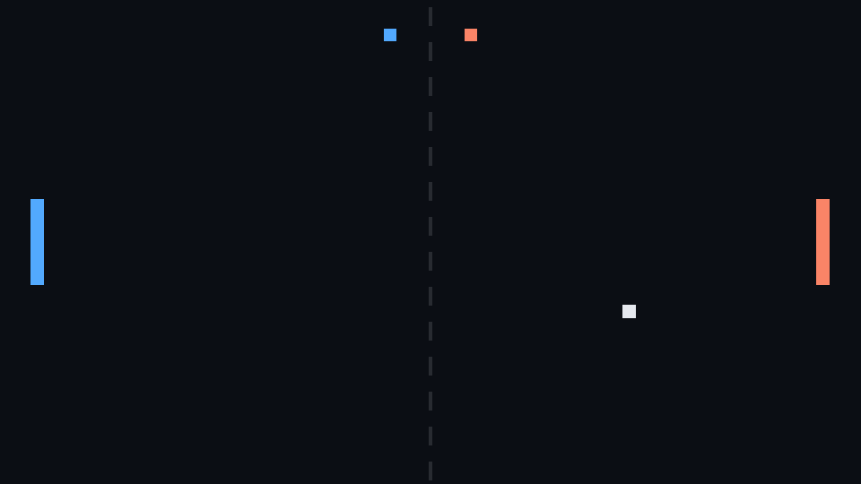
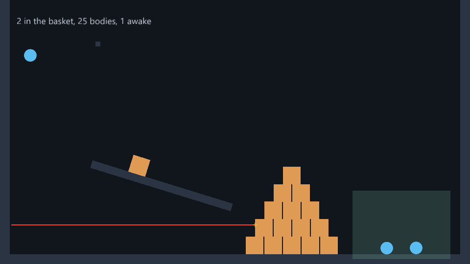

<p align="center">
  <picture>
    <source media="(prefers-color-scheme: dark)" srcset=".github/images/fluxion-logo-white.png">
    
  </picture>
</p>

<h1 align="center">Fluxion Engine</h1>

<p align="center">
  <strong>A window, a world, and the loop between them.</strong><br>
  A game engine for Zig 0.16: an ECS in the middle, a 2D and a 3D renderer, an interface layer, physics, scripts, and scenes kept as JSON or CBOR.
</p>

<p align="center">
  
  
  
  
  
</p>

<p align="center">
  <a href="#-how-it-is-put-together">How it is put together</a> ·
  <a href="#-what-is-in-it">What is in it</a> ·
  <a href="#-install">Install</a> ·
  <a href="#-examples">Examples</a> ·
  <a href="#-building-and-testing">Building and testing</a> ·
  <a href="#-what-comes-next">What comes next</a>
</p>



```zig
const fx = @import("fluxion_engine");

pub fn main(init: std.process.Init) !void {
    const app = try fx.App.create(init.gpa, .{ .title = "game", .io = init.io });
    defer app.destroy();

    try app.addSystem(.startup, "spawn", spawn);
    try app.addSystem(.fixed, "move", move);
    try app.run();
}

fn spawn(app: *fx.App) !void {
    _ = try app.world.spawnWith(.{
        fx.Transform2D.at(320, 180),
        fx.Sprite.solid(.hex(0x3AA0FF), 48, 48),
    });
}

fn move(app: *fx.App) !void {
    var it = try fx.Query(.{fx.Transform2D}).over(&app.world);
    while (it.next()) |chunk| {
        for (chunk.slice(fx.Transform2D)) |*place| {
            place.x += app.input.axisOf(.keys(.a, .d)) * 200 * app.time.delta;
        }
    }
}
```

This page is the short of it. The long of it is in the code: every call a
game makes is in `src/App.zig` with its documentation, and every component
is described where it is declared - which is also what a script's hover and
the editor's inspector show.

## 🧱 How it is put together

**A scene is a world, and a node is an entity.** A game goes: open a window,
put things in a scene, give them behaviour, draw - and the thing in the
middle is an ECS rather than a tree of objects with virtual methods on
them. Everything of one shape lives in one table, so a system is a loop over
plain slices. That is [Fluxion ECS](https://github.com/kisstp2006/fluxion-ecs)'
doing; what this package adds is the frame around it.

**A system is a plain function**, `fn (*App) anyerror!void`, added to one of
seven stages, and the list is the frame in order:

| Stage | When, and what belongs there |
| --- | --- |
| `startup` | Once, before the first frame. Spawn the world. |
| `input` | After the events are in. Turn keys into intent. |
| `fixed` | Zero or more times, at a constant delta, each followed by the physics step. Forces and steering. |
| `update` | Once, at whatever the frame took. Everything else. |
| `late` | After `update`, before anything is drawn. Cameras follow here. |
| `ui` | Last before drawing: declare the interface into `app.ui`. |
| `shutdown` | Once, after the last frame. |

The engine's own work goes between the stages, in one list:
`src/app/frame_steps.zig`. A press reaches exactly one fixed step whatever
the frame rate, and a frame too long to catch up with is dropped rather than
chased.

**Three layers, one target.** 3D first with a depth test, then 2D blended
with none, then the interface on top of both, each its own render pass into
the same surface, and what `app.debug` draws over all three.

**A component is a thing, not a mechanism.** `Sprite`, `RigidBody2D`,
`Camera3D`, `Timer`: each is something a person making a game would name,
plain data a scene can write down and an inspector can show. What exists so
that the engine can do its job - a body's handle, where something was a step
ago, an entity's name - is kept beside the world instead. A game's own
components are declared in the game, and the engine never hears of them
until they are registered for scenes.

## ✨ What is in it

| Area | What is there |
| --- | --- |
| The frame | Stages and a fixed step, commands that wait for a query to end, states, events, signals between components, timers, tweens, pause |
| Input | Keys and pointer as levels and edges, named actions a player can rebind, controllers, touch and gestures |
| The window | Its modes and screens, more than one window for tools, a game made at one size and stretched, the clipboard, the system's file dialogs |
| 2D | Sprites in one instanced draw per texture, text from one glyph atlas, cameras, animated sprites, particles, lights and shadows, tile maps, views drawn into textures |
| 3D | Meshes and glTF models with skeletons, materials and a surface's own shader, sun, point and spot lights with shadows, baked lightmaps and probes, probe volumes for the light from everywhere - baked, or lit again every frame - reflection probes, constructive solids, levels of detail, meshes streamed by their distance, fog, particles |
| The interface | An immediate layout in `app.ui`, and controls as entities with themes, focus and touch buttons |
| Physics | Rigid bodies, colliders, characters, areas, rays and picking, in 2D and in 3D; joints and ragdolls in 3D |
| Navigation | Navigation meshes baked from a level, agents, links and obstacles |
| Sound | Players, buses, and sound heard from where it is in 2D and 3D |
| Scenes | A world written as JSON or CBOR and read back, entities by UUID, scenes instanced in scenes, any file read in the background |
| Networking | Web requests that never stop the frame; networked play over UDP - a server players join, sealed end to end, messages on unreliable, sequenced and reliable channels, players passed each other's messages, the LAN's servers found - from Zig and from scripts (`net`) |
| The project | `res://`, `user://` and `uid://` paths, `project.fluxion` and its settings, plugins, config files and saves |
| Scripts | [Flux](https://github.com/kisstp2006/fluxion-script) scripts on entities, read again as they are saved |
| Reflection | Every component described - fields, defaults, ranges, units - and read, written and called by name |
| Shipping | A game packed into one file and run by `runtime/`, on Windows, Linux, Android and in a browser |

A few of them, as a game writes them.

**3D** is a mesh, a light and a camera, each an entity:

```zig
const red = try app.addMaterial("red", .{ .albedo_color = .hex(0xCC3333) });
_ = try app.world.spawnWith(.{
    fx.Transform3D.at(0, 0.5, 0),
    fx.MeshInstance3D{},
    fx.PrimitiveMesh3D{ .shape = .box },
    fx.Material3D{ .material = red },
});
var sun: fx.Transform3D = .{};
sun.lookAt(.init(-0.4, -1, -0.6), .unit_y);
_ = try app.world.spawnWith(.{ sun, fx.DirectionalLight3D{} });
var eye: fx.Transform3D = .at(0, 2, 5);
eye.lookAt(.zero, .unit_y);
_ = try app.world.spawnWith(.{ eye, fx.Camera3D{ .current = true } });
```

**Physics** is two components, and nothing in a game makes a body:

```zig
_ = try app.world.spawnWith(.{
    fx.Transform2D.at(480, 100).interpolated(),
    fx.Sprite.of(crate),
    fx.RigidBody2D{},
    fx.Collider2D{ .bounce = 0.3 },
});
```

**Scenes** are files a game holds, as it holds a texture:

```zig
try app.registerComponents(.{ Wander, Player });                       // the game's own
try app.saveScene("res://levels/meadow.json", .{});                    // to read, diff and edit
try app.saveScene("res://levels/meadow.scene", .{ .format = .cbor });  // the same, in fewer bytes

const bat = try app.loadScene("res://enemies/bat.json");               // a scene to make things of
const one = try app.instantiate(bat, cave);                            // its root, under cave
app.changeScene(try app.loadScene("res://levels/two.json"));          // at the end of the frame
```

**Scripts** go on entities: a `Script` component names a `.flux` file, and
the entity gets an instance of the struct in it.

```zig
// res://scripts/door.flux
struct Door {
    var open: bool = false;

    fn ready(self) {
        print("a door called", self.entity.name());
    }

    fn update(self, dt: float) {
        if (self.open) self.entity.get(Transform2D).rotation += dt;
    }
}
```

**The interface** is declared each frame by a `.ui` system:

```zig
fn pauseMenu(app: *fx.App) !void {
    app.ui.open(.{ .id = "resume", .padding = .all(12), .background_color = .hex(0x2E343D), .focus = .{} });
    defer app.ui.close();
    app.ui.text("Resume", .{ .font_size = 24 });
    if (app.ui.justReleased()) app.time.scale = 1;
}
```

### The project, and what it is drawn with

`project.fluxion` marks a project's folder: its name, its first scene, its
window, its input actions and its renderer, read by the game and by the
editor alike. The renderer chooses the graphics API, and `--backend` is
still over it:

| Renderer | APIs | Windows | Linux, Android | macOS | Browser |
| --- | --- | --- | --- | --- | --- |
| `compatibility` | Direct3D 11, OpenGL 3.3 | Direct3D 11, then OpenGL | OpenGL | OpenGL | WebGL 2 |
| `modern` (experimental) | Direct3D 12, Vulkan | Direct3D 12, then Vulkan | Vulkan | none | none |

### A shipped game

A shipped game is a pack - its files in one, its scripts compiled if the
export asks - and `runtime/` is the program that opens it: boot splash,
autoloads, main scene. Every loader reads through the project, so a texture
or a scene reads the same from a pack as from a folder. The editor's Export
does the packing.

```bash
zig build                                          # zig-out/bin/fluxion-runtime
zig build -Dtarget=x86_64-linux-gnu.2.31           # a Linux one, from any system
zig build -Dtarget=aarch64-linux-android           # zig-out/lib/libmain.so, with the Android NDK
zig build -Dtarget=wasm32-wasi -Doptimize=ReleaseSmall   # a page's module
```

## 📦 Install

```bash
zig fetch --save git+https://github.com/kisstp2006/fluxion-engine
```

```zig
const fluxion = b.dependency("fluxion_engine", .{ .target = target, .optimize = optimize });
exe_mod.addImport("fluxion_engine", fluxion.module("fluxion_engine"));
```

The libraries under it come with it, each pinned to a pushed commit, so
`zig fetch` builds the engine anywhere:

[ECS](https://github.com/kisstp2006/fluxion-ecs) ·
[RHI](https://github.com/kisstp2006/fluxion-rhi) ·
[Platform](https://github.com/kisstp2006/fluxion-platform) ·
[UI](https://github.com/kisstp2006/fluxion-ui) ·
[Shader](https://github.com/kisstp2006/fluxion-shader) ·
[Image](https://github.com/kisstp2006/fluxion-image) ·
[Font](https://github.com/kisstp2006/fluxion-font) ·
[Debug draw](https://github.com/kisstp2006/fluxion-debugdraw) ·
[JSON](https://github.com/kisstp2006/fluxion-json) ·
[Physics](https://github.com/kisstp2006/fluxion-physics) ·
[Physics 3D](https://github.com/kisstp2006/fluxion-physics3d) ·
[Reflect](https://github.com/kisstp2006/fluxion-reflect) ·
[Script](https://github.com/kisstp2006/fluxion-script) ·
[Audio](https://github.com/kisstp2006/fluxion-audio) ·
[VFS](https://github.com/kisstp2006/fluxion-vfs) ·
[Net](https://github.com/kisstp2006/fluxion-net) ·
[Session](https://github.com/kisstp2006/fluxion-session) ·
[Math](https://github.com/kisstp2006/fluxion-math) ·
[Id](https://github.com/kisstp2006/fluxion-id)

A change pushed to one of them reaches the engine when its pin moves:

```bash
zig fetch --save=fluxion_rhi git+https://github.com/kisstp2006/fluxion-rhi#<commit>
```

**Some pins have to agree.** A Zig package is identified by what it holds,
so `fluxion-math`, `fluxion-id` and `fluxion-jobs` are pinned where the
libraries that share them pin them; another commit would be two copies of
one library, and a compiler message reading
`expected type 'proj.Clip', found 'proj.Clip'`.

## 👾 Examples



<table>
  <tr>
    <td width="50%"></td>
    <td width="50%"></td>
  </tr>
</table>

| Example | What it shows |
| --- | --- |
| `example-pong` | A whole game in one file: two paddles, a ball and a scoreboard, with components of its own the engine has never heard of |
| `example-creatures` | The 2D layer: a sprite sheet, animation, things attached to other things, and a camera that follows |
| `example-crates` | Physics: crates, a ramp, a ball on a rod, a sensor that counts what falls into it, and a ray |
| `example-shapes` | The 3D layer: shapes made from numbers, the sun, a camera going round them, and a click that picks one |
| `example-light` | The light from everywhere: a room baked into a lightmap at startup, a probe volume - its light as baked, or lit again every frame as the lamp changes colour - and a reflection probe in a chrome ball |

```bash
zig build example-pong                      # Direct3D 11 on Windows, OpenGL elsewhere
zig build example-pong -- --backend gl      # OpenGL on Windows too
zig build example-pong -- --frames 420 --capture pong.png
```

The screenshots on this page are what each example's `--capture` wrote.

## 🧪 Building and testing

```bash
zig build                              # the runtime and every example, into zig-out/bin
zig build runtime-only                 # the runtime alone
zig build test                         # every test
zig build test-core -Dtest-filter=tile # the engine's own, and only those named so
zig build docs                         # the API's documentation, into zig-out/docs
```

**It runs with no window and no GPU.** `.headless = true` draws with a
backend that accepts every call and draws none, and moves the clock on by a
fixed amount each frame. Every test runs that way, which is why
`zig build test` passes on a machine with no display.

A game gets the engine's own flags in two lines - `--backend`, `--width`,
`--height`, `--frames`, `--capture`, `--stats`, `--vsync`, `--root` - with
room for its own beside them:

```zig
const flags = try App.parseFlags(App.Flags, arguments);
const app = try App.create(gpa, flags.apply(.{ .title = "game", .io = io }));
```

`--capture shot.png` keeps the last frame, the same picture on every
machine, and `--stats report.json` what each frame cost.

### Where the code is

`src/App.zig` is the app: the tables it keeps and every call a game makes.
The rest is in folders by what it is about:

| Folder | What is in it |
| --- | --- |
| `app/` | Options, the command line, and the frame's ordered list of passes |
| `core/` | The schedule of systems, commands, states, signals and events |
| `scene/` | The tree, names, UUIDs, groups, instances, and the scene file |
| `render/` | The 2D and 3D layers, materials and shaders, lights, particles, render views |
| `physics/`, `physics3d/` | Bodies, areas, characters, rays and picking; 3D joints and ragdolls |
| `navigation/`, `navmesh/` | Agents finding their way, and the mesh they walk baked |
| `assets/` | The tables of files of each kind, background loading, streamed meshes |
| `bake/`, `csg/`, `simplify/` | The lightmapper, solids cut from each other, and levels of detail made |
| `ui/`, `input/`, `audio/`, `animation/`, `tiles/`, `time/`, `math/` | What their names say |
| `script/`, `reflect/` | What a script sees of the engine, and how components are described |
| `project/`, `files/`, `net/`, `platform/` | The project and its plugins, a game's own files, web requests and networked play, the window |

Tests sit beside what they test, as `*_test.zig`. `runtime/` is the program
a shipped game runs, and `tools/` what the build runs.

## 🧭 What comes next

In order, and the order is an argument rather than a wish list:

1. **Building a level in the editor.** Solids added to, cut from and met
   with each other into one mesh and its collider, and an editor that
   changes its layout and its tools for the work at hand.
2. **Many things at once.** What a whole building full of detail needs, on
   a phone and in a browser too.

Not on the list yet: a typed store for state that is not a component - a
singleton entity is the answer today - whole systems run in parallel, and a
running game that watches its own pictures, sounds and scenes on disc.

**Two things that will catch you once.** A texture written back out as a
PNG drops its alpha unless `keep_alpha` is asked for, and draws as a row of
black squares. And a component may not contain a `packed struct`: use an
`extern struct`, as the engine's own handles do.

## 📜 Licence

BSD-3-Clause: see [`LICENSE`](LICENSE).

The runtime in `runtime/` - the program a game is shipped as - is under the
BSD 1-Clause licence of its own [`runtime/LICENSE`](runtime/LICENSE): a game
owes nobody a notice for it. What is built into it keeps its licence, and
the editor's export writes those beside the game.
